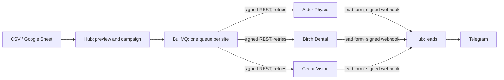

# PressFleet

Publish to a network of WordPress sites from one hub. Posts come in from a CSV file or a Google Sheet, a queue
publishes them to every site with retries and no duplicates, and each site runs a connector plugin with a signed REST
API, an admin screen, WP-CLI commands and a lead form block. The three demo sites share one block theme, built from an
HTML design, in three brands.

**[Live demo](https://hub.167-235-242-217.sslip.io)** · demo sites: [Alder Physio](https://alder.167-235-242-217.sslip.io),
[Birch Dental](https://birch.167-235-242-217.sslip.io), [Cedar Vision](https://cedar.167-235-242-217.sslip.io)

The sites, brands and articles are fictional.

## How it works



1. **Import.** One row is one post: title, Markdown or HTML, cover image URL, categories, tags, SEO title and
   description, slug, a publish date, and which sites get it. The hub previews the rows and flags problems before
   anything is published.
2. **A campaign is a matrix.** Every row × site pair is a delivery with its own status (queued, publishing,
   published, retrying, failed) and a link to the post. The dashboard updates live over server-sent events.
3. **The queue protects the sites.** Each site has its own queue with two requests at a time, so a slow host does not
   hold up the others and a small shared host is not flooded. Failed requests retry with exponential backoff and
   jitter; a 4xx that cannot succeed (a bad password, an invalid row) fails at once with the reason.
4. **The plugin makes it idempotent.** Posts are upserted by the row's ID, and a content hash means a repeated import
   answers "unchanged" without writing anything. Images are de-duplicated by URL and by file hash. A lock stops two
   requests for the same post from racing.
5. **Leads come back.** The Gutenberg form block saves each lead on the site first, then sends it to the hub with
   WP-Cron retries (1 min, 5 min, 30 min, 2 h, 12 h). The hub checks the site's signature and posts it to Telegram.

## Numbers

Measured on the local Docker setup (three WordPress 7.1 sites, PHP 8.4, one MariaDB):

| Scenario                                           | Result                                            |
| -------------------------------------------------- | ------------------------------------------------- |
| 50 posts × 3 sites, no images                      | 150 published in 8 s (≈1,100 a minute)            |
| The sample: 90 posts with cover images             | ≈9 s (≈600 a minute)                              |
| The same import again                              | 150 "unchanged", nothing written                  |
| A site stopped for 22 s mid-campaign               | 19 deliveries retried, 0 failed, 0 duplicates     |
| A site answering 503 for a whole run (demo button) | its 30 posts retried and landed on attempt 4      |
| The hub down while a visitor sends a lead          | saved on the site, delivered on the third attempt |
| Lighthouse, mobile, each demo home page            | 100 / 100 / 100 / 100 (LCP 1.4 s, CLS 0)          |

## What's in the repository

| Path                                                                 | What it is                                                      |
| -------------------------------------------------------------------- | --------------------------------------------------------------- |
| [`apps/api`](apps/api)                                               | Hub API: NestJS, BullMQ, Postgres (Drizzle), Redis              |
| [`apps/web`](apps/web)                                               | Hub dashboard: Next.js 16, Tailwind 4                           |
| [`packages/shared`](packages/shared)                                 | Import parser (CSV, Google Sheets), request signing, backoff    |
| [`wp/plugins/pressfleet-connector`](wp/plugins/pressfleet-connector) | The plugin every site runs                                      |
| [`wp/themes/pressfleet-theme`](wp/themes/pressfleet-theme)           | The block theme with three style variations                     |
| [`design/landing.html`](design/landing.html)                         | The static HTML design the theme was built from                 |
| [`infra`](infra)                                                     | Docker Compose for local sites and for the server, provisioning |

### The plugin

- **REST API** under `pressfleet/v1`: `POST /posts` (upsert), `GET /posts/{external_id}`, `GET /health`, and `/leads`
  for the form block.
- **Two layers of auth.** A WordPress Application Password of a user who can publish, plus an HMAC-SHA256 signature
  of the timestamp, method, route and body with a per-site secret. Requests older than five minutes are refused.
- **Content handling.** Categories and tags are created as needed, HTML goes through `wp_kses_post`, scheduled rows
  become `future` posts, and SEO fields go to Yoast or Rank Math when one is active, or to the plugin's own meta tags.
- **Admin.** Settings, a log of everything received and sent, and a leads screen with a retry action (`WP_List_Table`).
- **WP-CLI.** `wp pressfleet status | log | secret | leads | retry`.
- **Lead form block.** Built with `@wordpress/scripts`; the front end uses the Interactivity API (a script module, no
  React or jQuery on the page). Spam protection: a honeypot, a signed form token that must be at least 3 seconds old,
  and five submissions per IP an hour.
- **Case studies** are a custom post type registered by the plugin, not the theme, so they survive a theme change.
- **Quality.** WordPress Coding Standards (WordPress-Extra), PHPStan level 8 with WordPress stubs, and 35 PHPUnit
  integration tests in `wp-env` (upsert without duplicates, image de-duplication, signatures, permissions,
  sanitising, leads, the demo outage and reset).

### The theme

- A block theme converted from [`design/landing.html`](design/landing.html): `theme.json` holds the palette, type scale
  and spacing, and every section is a pattern (hero, stats, services, case studies, journal, testimonials, FAQ,
  contact with the lead form).
- Three style variations (`styles/alder.json`, `birch.json`, `cedar.json`) turn one theme into three brands: colours,
  fonts and copy. Everything can be edited in the Site Editor without code.
- Templates for the front page, blog, single posts, pages, archives, search, 404 and case studies. System font stacks, so
  there are no web fonts to download.

## The public demo

The live demo runs the same code with `DEMO_MODE=true`:

- campaigns publish the bundled sample only (50 fictional health articles with generated covers), one at a time and
  at most ten an hour, so visitors cannot post their own text to the live sites;
- sites cannot be added or removed;
- each site has a **Take offline** button: for a minute the plugin answers 503 to publishing, as a host that went
  down, so you can watch that site's deliveries retry while the others finish;
- every night the hub deletes what it published, clears the campaigns and publishes the sample again.

## Run locally

Requires Node 24, pnpm and Docker. PHP tooling runs in Docker too.

```bash
pnpm install
cp .env.example .env            # set WP_ADMIN_PASSWORD, API_INTERNAL_KEY and SECRETS_KEY
pnpm dev:wp                     # three sites on http://localhost:8081, 8082 and 8083
pnpm --filter @pressfleet/api build && pnpm --filter @pressfleet/api db:migrate
pnpm --filter @pressfleet/api dev        # API on :4000
pnpm --filter @pressfleet/web dev        # dashboard on http://localhost:3000
pnpm --filter @pressfleet/api sites:register
```

Open the dashboard, start a campaign with the sample and watch the matrix fill. To try a failure, run
`docker compose -f infra/docker-compose.yml stop site2` in the middle of a campaign and `start` it again.

### Checks

```bash
pnpm lint && pnpm typecheck && pnpm test         # TypeScript: ESLint, tsc, Vitest
pnpm php composer install
pnpm php composer lint                           # WordPress Coding Standards (plugin)
pnpm php composer lint:theme                     # WordPress Coding Standards (theme)
pnpm php composer analyse                        # PHPStan level 8
pnpm --filter @pressfleet/connector env:start    # wp-env
pnpm --filter @pressfleet/connector test:php     # PHPUnit
```

CI runs all of them on every push.

## Deploy

One small VPS runs everything: Caddy with automatic HTTPS, the dashboard, the API, Postgres, Redis, MariaDB and three
WordPress containers with the plugin and theme built into the image. The memory settings fit a 1 GB server with swap.
Without a domain, `sslip.io` gives the server's IP a hostname, so no DNS setup is needed.

```bash
ssh root@<ip> 'bash -s' < infra/prod/setup-server.sh                  # Docker, firewall, swap
infra/prod/deploy.sh root@<ip>                                         # builds the images here, ships code and images
ssh root@<ip> 'bash /opt/pressfleet/infra/prod/init-env.sh <ip-with-dashes>.sslip.io'
ssh root@<ip> 'bash /opt/pressfleet/infra/prod/up.sh --no-build'       # starts, provisions and registers the sites
```

Later deploys are `infra/prod/deploy.sh root@<ip>` alone. The hub is at `https://hub.<domain>` and the sites at
`https://alder.<domain>`, `birch.` and `cedar.`. Set `TELEGRAM_BOT_TOKEN` and `TELEGRAM_CHAT_ID` in
`/opt/pressfleet/.env.prod` to get leads in Telegram.

## Demo data

Generated for this project by `pnpm sample:generate`: the articles by Claude Haiku, the covers by a script (sharp). No
stock photos or third-party text.
